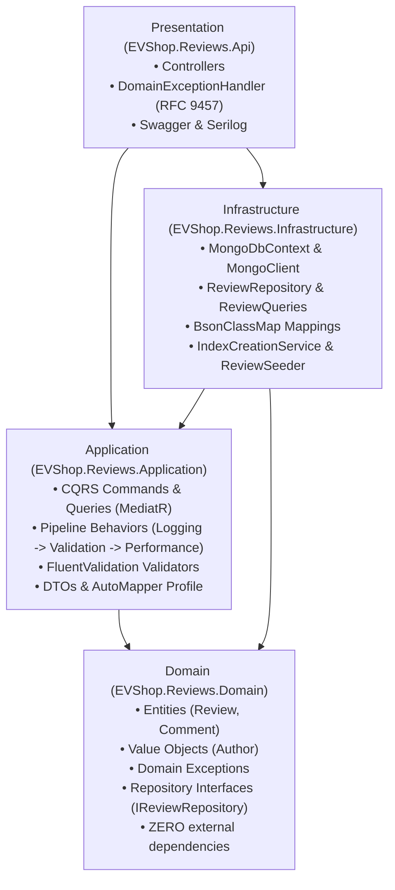

# Лабораторна робота №1: Проєктування та розробка баз даних для мікросервісної архітектури

**Дисципліна:** Технології .NET розробки Web-додатків / Розробка додатків на платформі .NET  
**Предметна область:** EV Conversional Shop (магазин компонентів та послуг переобладнання авто в електромобілі)  
**Гілка роботи:** `lab-1`

---

## 1. Короткий опис системи та контекстів

Для побудови системи обрано мікросервісний підхід із шаблоном **Database-per-Service** (кожен сервіс має власну ізольовану БД, міжсервісні FOREIGN KEY відсутні).

1. **Проєкт №1 — Ordering Service (Замовлення):**
   - **СУБД:** SQL Server 2022 (`EVShop_Ordering`).
   - **Технологія для Лаб 2:** ADO.NET + Dapper.
   - **Зв'язки:** 1:1 (`Orders` $\leftrightarrow$ `OrderDetails`), 1:N (`Customers` $\to$ `Orders`), M:N (`Orders` $\leftrightarrow$ `Products` через `OrderItems`).
   - **Функціонал:** 6 збережуваних процедур з транзакціями та блокуванням `WITH (UPDLOCK)` для безпечної зміни статусів замовлення, аудитні поля, soft delete, `RowVersion`.
2. **Проєкт №2 — Catalog Service (Каталог):**
   - **СУБД:** SQL Server 2022 (`EVShop_Catalog`).
   - **Технологія для Лаб 3:** EF Core (Code First + Fluent API).
   - **Зв'язки:** 1:1 (`Products` $\leftrightarrow$ `TechnicalSpecifications`), 1:N (`Brands` $\to$ `Products`, `Products` $\to$ `ProductImages`), M:N (`Products` $\leftrightarrow$ `Categories` через `ProductCategories` із власними полями `DateAdded` та `IsPrimary`).
3. **Проєкт №3 — Reviews & Community Service (Відгуки та спільнота):**
   - **СУБД:** MongoDB 7.0 (`evshop_reviews`).
   - **Технологія для Лаб 4:** MongoDB C# Driver.
   - **Колекції:** `reviews`, `discussions`, `conversion_showcases`.
   - **Особливості:** валідація схеми JSON Schema, embedding (вкладені коментарі), referencing (посилання на теми), поліморфні документи (різні набори полів для двигунів, акумуляторів, перехідних плит).

---

## 2. Політика дублювання даних між сервісами

| Дубльоване поле | Де зберігається | Сервіс-власник | Політика узгодженості |
| :--- | :--- | :--- | :--- |
| `OrderItems.ProductName`, `UnitPrice` | `EVShop_Ordering` | Каталог (`Products`) | **Snapshot (знімок):** Фіксується в момент покупки та не змінюється при подальшому редагуванні цін у каталозі. |
| `Products.Name`, `Price` (репліка) | `EVShop_Ordering` | Каталог (`Products`) | **Eventual Consistency:** Локальний довідник для швидкої перевірки та оформлення замовлення (актуалізується подіями). |
| `reviews.productName` | `evshop_reviews` | Каталог (`Products`) | **Read Projection:** Денормалізоване поле для показу карток відгуків без запитів до каталогу. |
| `reviews.author.displayName` | `evshop_reviews` | Замовлення / Клієнти | **Read Projection:** Кешується ім'я автора відгуку. |

---

## 3. Як розгорнути проєкт

Усі бази розгортаються локально в Docker без необхідності встановлення СКБД на систему.

### Крок 1. Запуск контейнерів
```bash
docker compose up -d
```
Служби:
- **SQL Server 2022:** `localhost:1433` (користувач `sa`, пароль `StrongPassw0rd!EV2026`)
- **MongoDB 7.0:** `localhost:27017` (користувач `admin`, пароль `AdminPassword123!`)
- **Mongo Express (Web GUI):** [http://localhost:8081](http://localhost:8081)

### Крок 2. Накатування схем та тестових даних
Виконайте скрипт автоматичного накатування та самоперевірки:
```powershell
powershell -ExecutionPolicy Bypass -File databases/scripts/run-init.ps1
```

Або вручну виконайте `init.sql` (у корені репозиторію) у будь-якому клієнті для SQL Server (SSMS / DBeaver), а файли з папки `databases/reviews-db/` у клієнті `mongosh`.

---

## 4. Перевірка роботи та критеріїв оцінювання

1. **Перевірка відсутності зовнішніх ключів між різними базами:**
   ```sql
   USE EVShop_Ordering;
   SELECT name, OBJECT_NAME(parent_object_id) AS ParentTable, OBJECT_NAME(referenced_object_id) AS RefTable 
   FROM sys.foreign_keys;
   ```
   Усі зв'язки ведуть тільки на таблиці поточної бази даних.

2. **Перевірка бізнес-правил (заборона відвантаження неоплаченого замовлення):**
   ```sql
   USE EVShop_Ordering;
   EXEC dbo.usp_ShipOrder @OrderId = 1001;
   -- Повертає керовану помилку THROW 50004
   ```

3. **Перевірка динамічних полів у MongoDB:**
   ```javascript
   use evshop_reviews;
   db.reviews.find({ dynoTestedTorqueNm: { $exists: true } });
   ```

---

## 5. ERD-діаграми баз даних

### Проєкт №1: Ordering DB (SQL Server)
```mermaid
erDiagram
    CUSTOMERS ||--o{ ORDERS : "1:N"
    ORDERS ||--|| ORDER_DETAILS : "1:1"
    ORDERS ||--o{ ORDER_ITEMS : "1:N"
    PRODUCTS_REPLICA ||--o{ ORDER_ITEMS : "1:N"
    ORDERS ||--o{ ORDER_STATUS_HISTORY : "1:N"

    CUSTOMERS {
        bigint Id PK
        nvarchar Email UK
        nvarchar FullName
    }
    ORDERS {
        bigint Id PK
        bigint CustomerId FK
        nvarchar Status
        decimal TotalAmount
        rowversion RowVersion
    }
    ORDER_DETAILS {
        bigint OrderId PK_FK
        nvarchar ShippingAddress
        nvarchar TargetVehicleModel
    }
    ORDER_ITEMS {
        bigint OrderId PK_FK
        bigint ProductId PK_FK
        nvarchar ProductName "Snapshot"
        decimal UnitPrice "Snapshot"
        int Quantity
    }
    PRODUCTS_REPLICA {
        bigint Id PK "No Remote FK"
        nvarchar Name
        decimal Price
    }
    ORDER_STATUS_HISTORY {
        bigint Id PK
        bigint OrderId FK
        nvarchar OldStatus
        nvarchar NewStatus
    }
```

### Проєкт №2: Catalog DB (SQL Server)
```mermaid
erDiagram
    BRANDS ||--o{ PRODUCTS : "1:N"
    PRODUCTS ||--|| TECHNICAL_SPECS : "1:1"
    PRODUCTS ||--o{ PRODUCT_IMAGES : "1:N"
    PRODUCTS ||--o{ PRODUCT_CATEGORIES : "M:N"
    CATEGORIES ||--o{ PRODUCT_CATEGORIES : "1:N"

    BRANDS {
        bigint Id PK
        nvarchar Name UK
    }
    PRODUCTS {
        bigint Id PK
        bigint BrandId FK
        nvarchar SKU UK
        nvarchar Name
        decimal BasePrice
        rowversion RowVersion
    }
    PRODUCT_CATEGORIES {
        bigint ProductId PK_FK
        bigint CategoryId PK_FK
        datetime2 DateAdded "Custom Field"
        bit IsPrimary "Custom Field"
    }
    TECHNICAL_SPECS {
        bigint ProductId PK_FK
        int OperatingVoltageV
        decimal PeakPowerKW
        decimal BatteryCapacityKWh
    }
    PRODUCT_IMAGES {
        bigint Id PK
        bigint ProductId FK
        nvarchar ImageUrl
    }
```

Код схем для [dbdiagram.io](https://dbdiagram.io/) знаходиться у файлі [docs/erd-diagrams.md](file:///k:/ЧНУ%20лаби%204%20курс/Лаби%20з%20.NET%20інженерії/Mini-project-EV-conversional-shop/docs/erd-diagrams.md).

---

## 6. Детальний опис та політика узгодженості

- [docs/bounded-contexts.md](file:///k:/ЧНУ%20лаби%204%20курс/Лаби%20з%20.NET%20інженерії/Mini-project-EV-conversional-shop/docs/bounded-contexts.md) — детальний опис меж контекстів та сутностей.
- [docs/data-duplication-policy.md](file:///k:/ЧНУ%20лаби%204%20курс/Лаби%20з%20.NET%20інженерії/Mini-project-EV-conversional-shop/docs/data-duplication-policy.md) — обґрунтування політики узгодженості та snapshot-патерну.
- [docs/erd-diagrams.md](file:///k:/ЧНУ%20лаби%204%20курс/Лаби%20з%20.NET%20інженерії/Mini-project-EV-conversional-shop/docs/erd-diagrams.md) — розширені діаграми та код для dbdiagram.io.

---

# Лабораторна робота №2: ASP.NET. Тришарова архітектура на базі ADO.NET та Dapper

**Дисципліна:** Технології .NET розробки Web-додатків / Розробка додатків на платформі .NET  
**Предметна область:** EV Conversional Shop (Ordering Service)  
**Гілка роботи:** `lab-02` (базується на гілці `lab-01`)

---

## 1. Архітектура та структура рішення (Vertical Slice / Three-Tier)

Мікросервіс замовлень (`Ordering Service`) реалізовано як самостійну вертикаль із чітко розмежованою тришаровою архітектурою та суворим однонаправленим потоком залежностей:
**Web/API** $\to$ **BLL** $\to$ **DAL**, зі спільним підключенням шару **Domain** у DAL та BLL.

```
       +-------------------------------------------------+
       |           EVShop.Ordering.Api                   |
       |  (Контролери, ProblemDetails RFC 9457, Swagger) |
       +-------------------------------------------------+
                               |
                               v
       +-------------------------------------------------+
       |           EVShop.Ordering.Bll                   |
       | (Сервіси IOrderService, DTOs, AutoMapper Profile)|
       +-------------------------------------------------+
                               |
                               v
       +-------------------------------------------------+
       |           EVShop.Ordering.Dal                   |
       |  (Unit of Work, ADO.NET + Dapper Repositories)  |
       +-------------------------------------------------+
                               |
                               v
       +-------------------------------------------------+
       |                SQL Server 2022                  |
       |  (EVShop_Ordering, SP usp_ConfirmOrder, Tables) |
       +-------------------------------------------------+
```

> **Правило чистої архітектури:** Жоден SQL-запит не з'являється поза межами DAL. Контролери API є тонкими адаптерами (thin adapters) і ніколи не звертаються до репозиторіїв чи бази даних напряму — виключно через сервіси бізнес-логіки BLL.

### Проєкти в рішенні:
1. `src/Services/Ordering/EVShop.Ordering.Domain` — доменні моделі (`Customer`, `Order`, `OrderItem`, `Product`, `OrderDetails`) та кастомні бізнес-винятки (`NotFoundException`, `BusinessConflictException`, `ValidationException`).
2. `src/Services/Ordering/EVShop.Ordering.Dal` — репозиторії даних:
   - Базовий клас `RepositoryBase` з єдиним підключенням `SqlConnection` та делегатом до поточної транзакції `SqlTransaction`.
   - Узагальнений репозиторій `BaseDapperRepository<T>` та інтерфейс `IGenericRepository<T>`.
   - `CustomerRepository` — **чистий ADO.NET** (`Microsoft.Data.SqlClient`) без сторонніх ORM, ручне мапіння через `SqlDataReader`, параметризовані запити, перехоплення помилок унікальності (`ex.Number 2601/2627`).
   - `OrderRepository` — **ADO.NET + Dapper** (`QueryAsync` з multi-mapping один-до-багатьох для замовлення та позицій, виклики збережуваних процедур `dbo.usp_ConfirmOrder`, `dbo.usp_CreateOrder`, `dbo.usp_PayOrder` тощо з перехопленням `THROW 50001`, `50002`).
   - `ProductRepository` — **ADO.NET + Dapper** з атомарним зменшенням залишку (`UPDATE dbo.Products SET StockQuantity = StockQuantity - @Quantity WHERE Id = @Id AND StockQuantity >= @Quantity`).
   - `UnitOfWork` — реалізація шаблону Unit of Work: координує спільне підключення та транзакцію `SqlTransaction` з рівнем ізоляції `IsolationLevel.ReadCommitted`, методи `BeginTransactionAsync`, `CommitAsync`, `RollbackAsync`, `DisposeAsync`.
3. `src/Services/Ordering/EVShop.Ordering.Bll` — бізнес-логіка:
   - DTOs із валідацією `System.ComponentModel.DataAnnotations` (`CreateOrderDto`, `CreateOrderItemDto`, `CreateCustomerDto`, `OrderDto`, `CustomerDto`).
   - Профілі `AutoMapper` (`OrderProfile`).
   - Сервіси `OrderService`, `CustomerService`. Метод `ConfirmOrderAsync` виконує бізнес-транзакцію: перевіряє статус, викликає збережувану процедуру `usp_ConfirmOrder` і атомарно зменшує залишок комплектуючих на складі; при нестачі товару викликає `RollbackAsync()`.
4. `src/Services/Ordering/EVShop.Ordering.Api` — веб-інтерфейс:
   - Асинхронні контролери (`OrdersController`, `CustomersController`) з передачею `CancellationToken`.
   - Централізований обробник винятків `DomainExceptionHandler` у форматі **ProblemDetails (RFC 9457)**.
   - OpenAPI / Swagger документація.
5. `src/EVShop.AppHost` — оркестратор **.NET Aspire** для одночасного запуску API та залежностей.
6. `tests/EVShop.Ordering.Tests` — модульні тести з використанням **xUnit** та **Moq**.

---

## 2. Гібридний шар доступу до даних: ADO.NET vs Dapper

| Характеристика | Репозиторій клієнтів (`CustomerRepository`) | Репозиторій замовлень (`OrderRepository`) |
| :--- | :--- | :--- |
| **Технологія** | Чистий **ADO.NET** (`Microsoft.Data.SqlClient`) | **Dapper** (Micro-ORM над ADO.NET) |
| **Generic Repository** | Свідомо **НЕ** успадковує `IGenericRepository<T>` | Успадковує `BaseDapperRepository<Order>` |
| **Мапінг даних** | Ручний через `SqlDataReader` та `reader.GetOrdinal(...)` | Автоматичний та `Multi-Mapping` (`Order` + `OrderItem`) |
| **Транзакції** | Працює через спільний `SqlTransaction` з UoW | Працює через спільний `SqlTransaction` з UoW |
| **Використання** | Базові операції з низьким оверхедом | Складні запити, JOIN, виклики Stored Procedures |

---

## 3. Транзакційний сценарій та Unit of Work

Бізнес-операція **«Підтвердження замовлення» (`ConfirmOrderAsync`)** гарантує властивості ACID для двох незалежних сутностей:

```
OrderService                   UnitOfWork             OrderRepository         ProductRepository        SQL Server
     |                              |                        |                        |                    |
     |--- BeginTransactionAsync --->|                        |                        |                    |
     |                              |------------------------|------------------------|---> BEGIN TRAN     |
     |--- ConfirmAsync(orderId) ---------------------------->|                        |                    |
     |                              |                        |--- usp_ConfirmOrder ----------------------->|
     |--- DecreaseStockAsync(item) -------------------------------------------------->|                    |
     |                              |                        |                        |---> UPDATE Stock ->|
     |                              |                        |                        |     (Check Stock)  |
     |-- [Якщо товару бракує] --------------------------------------------------------|                    |
     |--- RollbackAsync ----------->|                        |                        |                    |
     |                              |------------------------|------------------------|---> ROLLBACK TRAN  |
     |-- [Якщо все успішно] --------|                        |                        |                    |
     |--- CommitAsync ------------->|                        |                        |                    |
     |                              |------------------------|------------------------|---> COMMIT TRAN    |
```

Рівень ізоляції транзакції — **`IsolationLevel.ReadCommitted`**. Забезпечує захист від «брудного читання» (Dirty Read), водночас мінімізуючи блокування рядків у таблицях та уникаючи взаємних блокувань (Deadlocks).

---

## 4. Обробка помилок та RFC 9457 ProblemDetails

Усі винятки з БД або бізнес-правил транслюються в доменні винятки в DAL/BLL, а глобальний обробник `DomainExceptionHandler` формує стандартну відповідь `ProblemDetails`:

| Ситуація | Доменний виняток / Код БД | HTTP-статус | Title у ProblemDetails |
| :--- | :--- | :--- | :--- |
| Помилка валідації вхідних даних (DTO) | `ValidationException` / DataAnnotations | **400 Bad Request** | Помилка валідації даних |
| Замовлення або клієнта не знайдено | `NotFoundException` / `THROW 50001` | **404 Not Found** | Ресурс не знайдено |
| Недопустима зміна статусу (наприклад, повторне підтвердження) | `BusinessConflictException` / `THROW 50002` | **409 Conflict** | Конфлікт бізнес-правил |
| Недостатньо товару на складі | `BusinessConflictException` | **409 Conflict** | Конфлікт бізнес-правил |
| Порушення унікальності Email клієнта | `BusinessConflictException` / Error `2601, 2627` | **409 Conflict** | Конфлікт бізнес-правил |

Кожна відповідь з помилкою містить поле `traceId` (кореляційний ідентифікатор) для аудиту та трасування.

---

## 5. Запуск проєкту

### Варіант А. Запуск через .NET Aspire (Рекомендовано)
Aspire AppHost автоматично зв'язує API із базою даних і надає веб-дашборд моніторингу:
```bash
dotnet run --project src/EVShop.AppHost
```
Посилання на Aspire Dashboard виводиться в консоль (зазвичай `http://localhost:15xxx`).

### Варіант Б. Прямий запуск API
```bash
dotnet run --project src/Services/Ordering/EVShop.Ordering.Api --urls "http://localhost:5267"
```
- **Swagger UI:** [http://localhost:5267/swagger](http://localhost:5267/swagger)
- **OpenAPI Schema:** [http://localhost:5267/swagger/v1/swagger.json](http://localhost:5267/swagger/v1/swagger.json)

### Запуск тестів
```bash
dotnet test tests/EVShop.Ordering.Tests
```
Усі 5 тестів покривають конфігурацію AutoMapper, позитивні сценарії підтвердження та перевірку відкату транзакцій при браку товару.

---

## 6. Приклади перевірочних запитів (cURL)

### 1. Отримання клієнта (чистий ADO.NET)
```bash
curl -X GET "http://localhost:5267/api/customers/1" -H "Accept: application/json"
```

### 2. Захист від SQL Injection (перевірка спецсимволів: ім'я O'Brien)
```bash
curl -X POST "http://localhost:5267/api/customers" \
  -H "Content-Type: application/json" \
  -d '{"fullName":"Conan O'\''Brien","email":"conan.obrien@example.com","phoneNumber":"+380671234567"}'
```
*Результат:* HTTP 201 Created (запит успішно параметризовано, синтаксичної помилки SQL немає).

### 3. Створення нового замовлення
```bash
curl -X POST "http://localhost:5267/api/orders" \
  -H "Content-Type: application/json" \
  -d '{
    "customerId": 1,
    "shippingAddress": "м. Київ, вул. Хрещатик, 22, кв. 10",
    "contactPhone": "+380501112233",
    "targetVehicleModel": "BMW E30",
    "conversionType": "Full_Turnkey",
    "installationNotes": "Підготовка під мотор Nissan Leaf EM57",
    "items": [{"productId": 5001, "quantity": 2, "discount": 0}]
  }'
```
*Результат:* HTTP 201 Created із фіксацією ціни та назви товару у вигляді знімка (Snapshot).

### 4. Підтвердження замовлення (Транзакція UoW + usp_ConfirmOrder + списання залишку)
```bash
curl -X POST "http://localhost:5267/api/orders/11002/confirm"
```
*Результат:* HTTP 204 No Content. Залишок товару 5001 у базі зменшився з 8 до 6.

### 5. Повторне підтвердження (Конфлікт статусів)
```bash
curl -X POST "http://localhost:5267/api/orders/11002/confirm"
```
*Результат:* HTTP 409 Conflict (ProblemDetails з повідомленням від збережуваної процедури: *«Підтвердити наявність можна лише для нового замовлення...»*).

### 6. Запит неіснуючого замовлення
```bash
curl -X GET "http://localhost:5267/api/orders/99999"
```
*Результат:* HTTP 404 Not Found (ProblemDetails: *«Замовлення з ID 99999 не знайдено»*).

### 7. Відкат транзакції при перевищенні залишку товару
Спроба підтвердження замовлення на кількість, більшу за залишок на складі (наприклад, 10 одиниць товару 5003 при залишку 5):
```bash
curl -X POST "http://localhost:5267/api/orders/11003/confirm"
```
*Результат:* HTTP 409 Conflict (*«Недостатньо залишку на складі...»*). Статус замовлення відкочується назад у `Submitted`, а залишок товару не змінюється.

---

## 7. Відповіді на контрольні питання

### 1. З яких шарів складається тришарова архітектура і в якому напрямку спрямовані залежності між ними?
**Відповідь:** Тришарова архітектура складається з:
1. **Presentation / Web API Layer** (контролери, валідація DTO, middleware обробки помилок, маршрутизація).
2. **Business Logic Layer (BLL)** (сервіси бізнес-логіки, оркестрація транзакцій, перевірка інваріантів, мапінг DTO/сутностей).
3. **Data Access Layer (DAL)** (репозиторії даних, Unit of Work, SQL-команди, з'єднання з БД).
4. **Domain Layer** (моделі сутностей, винятки) — спільне ядро.

Залежності спрямовані строго в один бік: **API $\to$ BLL $\to$ DAL**. Контролери нічого не знають про репозиторії чи деталі збереження даних у БД і спілкуються виключно з інтерфейсами BLL.

### 2. Чому інтерфейс репозиторію повинен повертати модель чи DTO, а не SqlDataReader чи DataTable?
**Відповідь:** 
1. **Інкапсуляція деталей інфраструктури:** `SqlDataReader` та `DataTable` прив'язують зовнішній код до конкретної СКБД (SQL Server) та технології ADO.NET. При переході на PostgreSQL, MySQL або ORM (EF Core) довелося б переписувати BLL.
2. **Управління ресурсами:** `SqlDataReader` тримає з'єднання з базою даних відкритим, поки читач не закрито. Повернення читача у вищі шари призводить до витоку підключень у пулі (Connection Pool starvation).
3. **Типобезпека та тестованість:** Моделі та DTO легко мокати у Unit-тестах без необхідності піднімати реальну СКБД.

### 3. Навіщо потрібен Generic Repository? Чому ADO.NET-репозиторій у цій роботі його свідомо не успадковує?
**Відповідь:** `Generic Repository<T>` реалізує принцип DRY (Don't Repeat Yourself), узагальнюючи повторювані базові CRUD-операції (`GetById`, `GetAll`, `Add`, `Delete`). 
ADO.NET-репозиторій (`CustomerRepository`) свідомо не успадковує `Generic Repository`, оскільки:
- Демонструє фундаментальну роботу з `Microsoft.Data.SqlClient` «з нуля» (без динамічної генерації SQL);
- Ручне мапіння полів через `SqlDataReader` для кожної сутності унікальне;
- Відокремлює спеціалізовану оптимізовану роботу від узагальнених абстракцій.

### 4. Чим відрізняється робота з тим самим запитом через чистий ADO.NET і через Dapper? Коли виправдано писати «руками»?
**Відповідь:**
- **ADO.NET:** вимагає самостійного створення `SqlCommand`, додавання параметрів із типами даних, відкриття `SqlDataReader` та вичитування кожного стовпця за індексом/іменем (`reader.GetString(...)`).
- **Dapper:** це micro-ORM, що автоматизує генерацію команд, параметризацію анонімних об'єктів та рефлексивне зіставлення колонок SQL із властивостями C#-класів (включно з multi-mapping для зв'язків 1:N).
- **Коли писати руками на ADO.NET:**
  1. Стрімінгове читання гігантських обсягів даних через `CommandBehavior.SequentialAccess` (наприклад, читання великих BLOB або експорт мільйонів рядків без завантаження всієї вибірки в пам'ять).
  2. Масове завантаження через `SqlBulkCopy`.
  3. Максимально критичні до мікросекундної швидкодії операції без оверхеду навіть мінімальної рефлексії.

### 5. Чому конкатенація рядків у SQL-запиті небезпечна, навіть якщо значення «просто Id»?
**Відповідь:**
1. **SQL Injection:** Якщо тип змінної у рядку прийшов як рядок або не провалідований, зловмисник може передати `1 OR 1=1; DROP TABLE Customers;--`.
2. **Засмічення кешу планів запитів (Plan Cache Bloat):** При конкатенації `SELECT * FROM Orders WHERE Id = 1` та `WHERE Id = 2` SQL Server сприймає це як два абсолютно різних запити і щоразу будує новий план виконання. Параметризація (`WHERE Id = @Id`) дозволяє кешувати і повторно використовувати скомпільований план виконання.
3. **Локалізація та типи:** Конкатенація чисел із плаваючою комою або дат може викликати синтаксичну помилку через роздільники крапка/кома в різних локалях ОС.

### 6. Як Unit of Work гарантує, що кілька репозиторіїв працюють в одній транзакції? Що станеться, якщо один із них не отримає той самий SqlTransaction?
**Відповідь:** Unit of Work створює **одне** спільне з'єднання `SqlConnection` та відкриває **одну** транзакцію `SqlTransaction`. Усі репозиторії (`Customers`, `Orders`, `Products`) успадковують `RepositoryBase` і отримують доступ до поточної транзакції через делегат `Func<SqlTransaction?>`. 
- Якщо хоча б один репозиторій виконає запит без прив'язки до цієї `SqlTransaction`, SqlClient кине виняток: *«Execute requires the command to have a transaction when the connection assigned to the command is in a pending local transaction»*, або запит виконається поза транзакцією, зруйнувавши атомарність і цілісність даних.

### 7. Як помилка, кинута збережуваною процедурою, перетворюється на HTTP-статус 409 для клієнта?
**Відповідь:** Ланцюжок трансляції:
1. **SQL Server:** Процедура `usp_ConfirmOrder` перевіряє статус замовлення. Якщо воно вже підтверджене, викликається `THROW 50002, '...', 1;`.
2. **DAL:** Dapper/ADO.NET перехоплює `SqlException` з номером `ex.Number == 50002`. Метод `TranslateSqlException` загортає її в доменний виняток `BusinessConflictException`.
3. **BLL:** Пропускає доменний виняток нагору без викривлення.
4. **Web/API:** `DomainExceptionHandler` через патерн-матчинг перетворює `BusinessConflictException` на `StatusCodes.Status409Conflict` та записує відповідь у стандарті RFC 9457 `ProblemDetails`.

### 8. Чому потрібні обидва рівні валідації — на DTO і в BLL?
**Відповідь:**
- **Валідація DTO (API рівень):** перевіряє формат і форму даних без звернення до сховища (наявність обов'язкових полів, довжина рядка, коректність email/телефону, додатні числа). Це відсікає сміттєві запити на самому початку конвеєра (`Fail-Fast`), заощаджуючи ресурси процесора та БД.
- **Бізнес-валідація (BLL рівень):** перевіряє стан системи та доменні інваріанти, які потребують доступу до бази даних (чи існує такий клієнт, чи статус замовлення дозволяє його редагування, чи достатньо товару на складі).

### 9. Яка різниця між optimistic і pessimistic concurrency? Коли доречний кожен підхід?
**Відповідь:**
- **Optimistic Concurrency:** Рядки не блокуються при читанні. Використовується стовпець версії (`rowversion` / `xmin`). Під час запису перевіряється, чи версія не змінилася (`UPDATE ... WHERE Id = @Id AND RowVersion = @OldVersion`). Якщо змінена — кидається виняток конфлікту.
  *Доречно:* коли конкурентні зміни рідкісні, переважна більшість операцій — читання, низька ціна повтору операції.
- **Pessimistic Concurrency:** Рядок явно блокується в момент читання (наприклад, `SELECT ... WITH (UPDLOCK, ROWLOCK)` у процедурах Лаб. 01). Інші транзакції чекають завершення першої.
  *Доречно:* коли ймовірність одночасного конфлікту висока (наприклад, списання дефіцитного товару під час розпродажу або банківські операції), де відкат і повтор для користувача неприйнятні.

### 10. Чому статус 500 у відповідь на «запис не знайдено» — помилка проєктування API?
**Відповідь:**
- Статус **500 Internal Server Error** означає непередбачену помилку на стороні сервера (падіння програми, збій з'єднання з БД, NullReferenceException, дефекти коду). Системи моніторингу (Datadog, Prometheus, Sentry) трактують статус 500 як аварійну ситуацію, що вимагає втручання чергового інженера.
- «Запис не знайдено» — це штатна, очікувана ситуація бізнес-домену, викликана клієнтом, що передав неіснуючий ідентифікатор. Згідно зі стандартом HTTP / REST, клієнтською помилкою відсутності ресурсу є **404 Not Found**.

### 11. Навіщо .NET Aspire AppHost потрібен уже на цьому етапі, якщо Gateway й Aggregator з’являться лише в Лаб. 05?
**Відповідь:**
1. **Єдиний запуск усього середовища:** AppHost дозволяє підняти API, бази даних, черги та залежності однією командою (`dotnet run --project src/EVShop.AppHost`) без необхідності відкривати кілька консолей.
2. **Централізоване управління конфігурацією:** Aspire автоматично прокидує Service Discovery та рядки підключення через системні змінні середовища, усуваючи hardcode портів та адрес.
3. **OpenTelemetry Dashboard «з коробки»:** Уже з Лабораторної №2 розробник має інтерактивний дашборд із логами в реальному часі, метриками запитів, трасуванням Distributed Tracing та статусом здоров'я сервісів.

---

# Лабораторна робота №3: ASP.NET. Тришарова архітектура на базі Entity Framework Core

**Дисципліна:** Технології .NET розробки Web-додатків / Розробка додатків на платформі .NET  
**Мікросервіс:** `EVShop.Catalog` (Каталог компонентів та обладнання для переобладнання електромобілів)  
**Гілка роботи:** `lab-03`  
**Стек технологій:** .NET 10, Entity Framework Core 10 (Code-First), SQL Server 2022, Ardalis.Specification, AutoMapper, FluentValidation, Serilog, .NET Aspire, Swagger / OpenAPI, xUnit & Moq.

---

## 1. Архітектура сервісу каталогу (Code-First)

Сервіс `EVShop.Catalog` побудовано за тришаровою архітектурою з централізованим використанням ORM Entity Framework Core:

```
┌────────────────────────────────────────────────────────┐
│            EVShop.Catalog.Api (Web / Presentation)     │
│  Controllers, Routing, Swagger, DomainExceptionHandler │
└──────────────────────────┬─────────────────────────────┘
                           │ залежить від
┌──────────────────────────▼─────────────────────────────┐
│            EVShop.Catalog.Bll (Business Logic Layer)   │
│  Services, DTOs, AutoMapper, FluentValidation, Specs   │
└──────────────────────────┬─────────────────────────────┘
                           │ залежить від
┌──────────────────────────▼─────────────────────────────┐
│            EVShop.Catalog.Dal (Data Access Layer)      │
│  CatalogDbContext, Fluent API Configurations,          │
│  GenericRepository<T>, 3 Специфічні Репозиторії, UoW,  │
│  Міграції (EF Migrations) та Ідемпотентний Сідінг      │
└──────────────────────────┬─────────────────────────────┘
                           │ залежить від
┌──────────────────────────▼─────────────────────────────┐
│            EVShop.Catalog.Domain (Domain Models)       │
│  Product (Rich Entity: AddStock, RemoveStock),         │
│  Category, ProductCategory (M:N), ProductDetail (1:1), │
│  ProductImage (1:N), Brand, Domain Exceptions          │
└────────────────────────────────────────────────────────┘
```

---

## 2. Ключові технічні рішення

### 2.1. Багата доменна модель (Rich Domain Model)
- Сутність `Product` інкапсулює свої властивості з `private set`.
- Зміна складських залишків можлива виключно через доменні методи:
  - `AddStock(quantity)`: перевіряє `quantity > 0` і збільшує `AvailableStock`.
  - `RemoveStock(quantity)`: перевіряє `AvailableStock >= quantity`; при нестачі викидає `DomainException`, що транслюється в HTTP 409 Conflict.
  - `UpdatePrice(newPrice)`: перевіряє `newPrice > 0`.

### 2.2. Конфігурації Fluent API (`IEntityTypeConfiguration<T>`)
Кожна сутність має ізольований конфігураційний клас:
- `ProductConfiguration`: CHECK-обмеження `[Price] > 0` та `[AvailableStock] >= 0`, унікальний індекс на `Sku`, оптимістична конкурентність через `IsRowVersion()`.
- `ProductCategoryConfiguration`: складений первинний ключ `(ProductId, CategoryId)` та власне поле `AddedAt` з `SYSUTCDATETIME()`.
- `ProductDetailConfiguration`: зв'язок 1:1, де `ProductId` є водночас PK і FK.
- `BrandConfiguration` та `CategoryConfiguration`: статичний сідінг довідників через `HasData`.

### 2.3. Три стратегії завантаження даних (Loading Strategies)
1. **Eager Loading (`Include` / `ThenInclude`):**
   - Метод `ProductRepository.GetWithDetailsAsync(id)` завантажує товар, детальні характеристики, картинки, бренд та категорії **одним SQL-запитом** із JOIN.
2. **Explicit Loading (`Entry().Collection().LoadAsync()`):**
   - Метод `CategoryRepository.GetWithProductsAsync(id)` завантажує категорію першим запитом, а пов'язані товари довантажує **окремим другим SQL-запитом** лише за потреби.
3. **LINQ to Entities через M:N:**
   - Метод `ProductCategoryRepository.GetRecentlyAddedAsync(category, since)` виконує вибірку через проміжну таблицю з фільтрацією за `AddedAt >= since` та проекцією на `Product`.

### 2.4. Патерн Специфікація (Specification Pattern)
- Складна бізнес-вибірка винесена з контролерів та сервісу у клас `ProductsFilterSpec` (`Ardalis.Specification`).
- Підтримує пошук за назвою та SKU, фільтрацію за діапазоном цін, брендами та категоріями, сортування (`asc`/`desc` за ціною та назвою) та посторінкову розбивку (`Skip` / `Take`).
- Виконується на рівні бази даних через LINQ to Entities до виклику `ToListAsync()`.

### 2.5. Дворівнева валідація
- **Рівень API (DTO):** атрибути `DataAnnotations` (`[Required]`, `[Range]`, `[StringLength]`).
- **Рівень BLL (Бізнес-правила):** валідатор `CreateProductDtoValidator` на базі `FluentValidation` з перевіркою формату SKU регулярним виразом `^[A-Za-z0-9-]+$` та меж робочої напруги.
- Контролер викликає валідатор явно та повертає стандартний `ValidationProblemDetails` (HTTP 400).

### 2.6. Ідемпотентний сідінг (Data Seeding)
- **Статичний сідінг:** через метод `builder.HasData(...)` у конфігураціях Fluent API для категорій та брендів.
- **Програмний сідінг:** у класі `DbInitializer.SeedAsync` при старті застосунку з обов'язковою перевіркою `if (await db.Products.AnyAsync()) return;`, що гарантує відсутність дублювання записів при повторних запусках у CI/CD.

---

## 3. Як запустити та перевірити

### Крок 1. Запуск через .NET Aspire
Запустіть всю екосистему мікросервісів однією командою:
```powershell
dotnet run --project .\src\EVShop.AppHost
```
У консолі відобразиться посилання на Aspire Dashboard, де працюють:
- `orders-api` (Лаб 2)
- `catalog-api` (Лаб 3)
- Бази даних `OrdersDb` та `CatalogDb`

Swagger Каталогу доступний за адресою:
`http://localhost:5242/swagger` (або порт, вказаний в Aspire Dashboard).

### Крок 2. Автономні міграції EF Core
Міграції застосовуються автоматично при старті, але також доступні через `dotnet-ef`:
```powershell
# Застосувати міграцію до БД
dotnet ef database update --project src/Services/Catalog/EVShop.Catalog.Dal --startup-project src/Services/Catalog/EVShop.Catalog.Api

# Згенерувати ідемпотентний SQL-скрипт міграції
dotnet ef migrations script --project src/Services/Catalog/EVShop.Catalog.Dal --startup-project src/Services/Catalog/EVShop.Catalog.Api --output src/Services/Catalog/EVShop.Catalog.Dal/Migrations/InitialCreate.sql --idempotent
```

### Крок 3. Запуск Unit-тестів
```powershell
dotnet test src/EVShop.sln
```
Усі 21 тест (16 тестів Catalog + 5 тестів Ordering) проходять успішно!

---

## 4. Приклади cURL запитів для перевірки API

### 1. Отримання товарів з пагінацією та фільтрацією (HTTP 200 OK)
```bash
curl -X GET "http://localhost:5242/api/products?page=1&pageSize=5&sortBy=price&sortDir=desc" \
     -H "Accept: application/json"
```

### 2. Отримання товару за ID (Eager Loading — 1 SQL JOIN) (HTTP 200 OK)
```bash
curl -X GET "http://localhost:5242/api/products/1" \
     -H "Accept: application/json"
```

### 3. Створення нового товару (HTTP 201 Created + Location)
```bash
curl -X POST "http://localhost:5242/api/products" \
     -H "Content-Type: application/json" \
     -d '{
       "name": "Curtis AC F2-A Motor Controller",
       "sku": "CTRL-CURTIS-F2A",
       "price": 1850.00,
       "availableStock": 5,
       "brandId": 2,
       "categoryId": 2,
       "description": "Сучасний інвертор для електродвигунів",
       "operatingVoltageV": 96
     }'
```

### 4. Помилка валідації вхідних даних (HTTP 400 ValidationProblemDetails)
```bash
curl -X POST "http://localhost:5242/api/products" \
     -H "Content-Type: application/json" \
     -d '{
       "name": "",
       "sku": "INVALID SKU WITH SPACES",
       "price": -50.00,
       "availableStock": -1
     }'
```

### 5. Конфлікт унікальності SKU (HTTP 409 Conflict)
Повторне створення товару з тим самим SKU повертає 409:
```bash
curl -X POST "http://localhost:5242/api/products" \
     -H "Content-Type: application/json" \
     -d '{
       "name": "Hyper9 Motor Duplicate",
       "sku": "MOT-HYPER9-100V",
       "price": 4850.00,
       "availableStock": 1
     }'
```

### 6. Списання залишку понад наявний (HTTP 409 Conflict)
Спроба списати більше товару, ніж є в наявності:
```bash
curl -X POST "http://localhost:5242/api/products/1/stock/remove" \
     -H "Content-Type: application/json" \
     -d '{"quantity": 9999}'
```

### 7. Explicit Loading категорії (2 окремі SQL-запити в консолі) (HTTP 200 OK)
```bash
curl -X GET "http://localhost:5242/api/categories/1/products" \
     -H "Accept: application/json"
```

### 8. Запит неіснуючого ресурсу (HTTP 404 ProblemDetails)
```bash
curl -X GET "http://localhost:5242/api/products/99999" \
     -H "Accept: application/json"
```

---

## 5. Відповіді на контрольні питання до Лабораторної роботи №3

### 1. Чим підхід Code-First відрізняється від Database-First? Яку роль відіграють міграції?
**Відповідь:**
- **Code-First:** Єдиним першоджерелом істини (Single Source of Truth) є C#-класи доменної моделі та конфігурації Fluent API. Схема реляційної бази даних автоматично генерується з C#-коду. Це дає повний контроль над об'єктно-орієнтованим дизайном, типами та інкапсуляцією.
- **Database-First:** Першоджерелом є готова база даних у СКБД, з якої за допомогою утиліт scaffolding (наприклад, `dotnet ef dbcontext scaffold`) генеруються C#-класи.
- **Роль міграцій:** Міграції EF Core виконують версіонування структури бази даних (подібно до Git для коду). Вони фіксують різницю між попереднім та новим станом моделі у вигляді C#-коду (`Up` та `Down` методи), що дозволяє відтворювати схему на будь-якому середовищі (Dev, Test, Prod), застосовувати зміни без втрати даних та безпечно відкочуватися назад.

### 2. Навіщо виносити конфігурацію сутностей в окремі класи `IEntityTypeConfiguration<T>`, якщо її можна написати прямо в `OnModelCreating`?
**Відповідь:**
1. **Принцип єдиного обов'язку (SRP) та чистота коду:** Якщо в системі десятки сутностей, метод `OnModelCreating` розростається до тисяч рядків спагетті-коду, в якому важко орієнтуватися і який конфліктує під час Git Merge.
2. **Модульність та автовиявлення:** Винесення налаштувань в окремі класи (наприклад, `ProductConfiguration`, `CategoryConfiguration`) дозволяє застосувати всі конфігурації автоматично одним рядком: `modelBuilder.ApplyConfigurationsFromAssembly(...)`.
3. **Ізоляція домену від деталей персистентності:** Самі доменні сутності залишаються «чистими» POCO-класами без технічних атрибутів EF Core.

### 3. Чому для M:N іноді потрібна явна проміжна сутність (`UserRole`, `ProductCategory`), хоча EF Core вміє будувати M:N автоматично?
**Відповідь:**
- Автоматичний зв'язок M:N в EF Core створює «невидиму» тіньову проміжну таблицю, яка містить лише два зовнішні ключі (`ProductId`, `CategoryId`).
- Проте в реальних бізнес-доменах зв'язок «багато до багатьох» майже завжди має **власні бізнес-атрибути**. Наприклад:
  - `AddedAt` — дата додавання товару в дану категорію (для сортування за новинками);
  - `IsPrimary` — прапорець, що визначає основну категорію для побудови URL/хлібних крихт;
  - `AssignedBy` — аудит користувача.
- Без явної проміжної сутності (`ProductCategory`) додати та мапити ці корисні поля неможливо.

### 4. Чим Eager Loading відрізняється від Explicit Loading за кількістю та моментом виконання SQL-запитів? Коли доречний кожен підхід?
**Відповідь:**
- **Eager Loading (`Include` / `ThenInclude`):**
  - *Кількість запитів:* **1 SQL-запит** (з використанням `LEFT JOIN`).
  - *Момент:* Пов'язані дані завантажуються одразу разом із головною сутністю.
  - *Коли доречно:* Коли ми точно знаємо, що зв'язані дані потрібні на поточному екрані (наприклад, картка товару, де завжди потрібні картинки, характеристики та категорії).
- **Explicit Loading (`Entry().Collection().LoadAsync()`):**
  - *Кількість запитів:* **2 (або більше) окремих SQL-запити**.
  - *Момент:* Спочатку читається батьківський запис, а залежна колекція завантажується явно у коді пізніше, лише якщо виконано певну бізнес-умову.
  - *Коли доречно:* Коли дочірня колекція дуже велика або потрібна рідко (наприклад, завантажуємо клієнта, і лише якщо його статус `Premium`, довантажуємо його історію замовлень з фільтрацією).

### 5. Чому `SaveChangesAsync()` викликається один раз у Unit of Work, а не в кожному репозиторії?
**Відповідь:**
1. **Атомарність транзакції (ACID):** `SaveChangesAsync()` виконує всі накопичені операції додавання, оновлення та видалення в межах однієї транзакції бази даних. Якщо будь-який запис дасть збій, жодні зміни не збережуться.
2. **Мінімізація мережевих запитів (Batching):** EF Core об'єднує кілька команд `INSERT` / `UPDATE` в один пакетний мережевий виклик до SQL Server, суттєво підвищуючи продуктивність.
3. **Роль репозиторію:** Репозиторій є лише колекцією об'єктів у пам'яті (in-memory collection abstraction) і відповідає за зміну стану сутностей у Change Tracker, тоді як Unit of Work відповідає за фіксацію транзакційного результату.

### 6. Чому бізнес-правила (наприклад, списання залишку) краще реалізовувати методами сутності, а не відкритими setter-ами?
**Відповідь:**
1. **Інкапсуляція та захист інваріантів:** Відкритий setter `AvailableStock = -10` дозволяє зовнішньому коду перевести систему в невалідний стан. Метод `RemoveStock(quantity)` гарантує, що кількість не перевищує доступну, і кидає доменний виняток при спробі порушити інваріант.
2. **Єдине місце логіки:** Бізнес-правило розташоване в самій сутності, а не дублюється в десяти різних сервісах, фонових завданнях чи контролерах.
3. **DDD-підхід (Rich Domain Model проти Anemic Domain Model):** Сутність перестає бути пасивним мішком даних і стає активним учасником доменної логіки.

### 7. Чому пагінацію й фільтрацію потрібно виконувати до `ToListAsync()`, а не після?
**Відповідь:**
- **До `ToListAsync()` (`IQueryable`):** LINQ-оператори `Where(...)`, `OrderBy(...)`, `Skip(...)`, `Take(...)` транслюються провайдером EF Core у нативний SQL-вираз:
  `SELECT ... FROM Products WHERE ... ORDER BY ... OFFSET @skip ROWS FETCH NEXT @pageSize ROWS ONLY`.
  База даних фільтрує мільйон рядків на диску за індексами і повертає по мережі в пам'ять програми лише запитані 20 об'єктів.
- **Після `ToListAsync()` (`IEnumerable` в пам'яті):** Виклик `ToListAsync()` вивантажить усю таблицю (наприклад, 500,000 товарів) через мережу в оперативну пам'ять сервера, що миттєво призведе до навантаження на пам'ять (High Memory Pressure), OutOfMemoryException та критичного сповільнення системи.

### 8. Яка різниця між DataAnnotations і FluentValidation? Чому проєкт використовує обидва підходи?
**Відповідь:**
- **DataAnnotations:** Прості атрибути над полями DTO (`[Required]`, `[Range]`, `[StringLength]`). Вони чудово підходять для базової перевірки форми даних і автоматично підхоплюються Swagger / OpenAPI для генерації красивої документації схем.
- **FluentValidation:** Повнофункціональна бібліотека валідації, де правила описуються у виділених C#-класах. Вона підтримує складні умовні перевірки (`When(...)`), валідацію за регулярними виразами, кастомні повідомлення різними мовами та залежності від сервісів.
- **Чому обидва:** Розділення зон відповідальності: DataAnnotations слугують першим швидким фільтром та схемою для OpenAPI, а FluentValidation забезпечує глибоку, тестовану бізнес-валідацію без засмічення DTO.

### 9. Чому сучасна документація FluentValidation рекомендує ручну валідацію замість автоматичного middleware?
**Відповідь:**
1. **Асинхронність:** Автоматична валідація в старих версіях MVC виконувалася синхронно, що блокувало потоки при асинхронних правилах (наприклад, перевірці унікальності в БД).
2. **Явний потік виконання (Explicit Control):** Ручний виклик `await validator.ValidateAsync(input, ct)` у контролері робить код прозорим, зрозумілим і передбачуваним під час зневадження.
3. **Гнучкість обробки помилок:** Дозволяє самостійно сформувати стандартну відповідь `ValidationProblemDetails` (RFC 9457) з точним мапінгом помилок, не покладаючись на неявні внутрішні фільтри ASP.NET.
4. **Офіційна депрекація:** Розробники бібліотеки FluentValidation офіційно оголосили інтеграцію `AddFluentValidation()` застарілою через численні підводні камені сумісності з ASP.NET Core Minimal APIs та валідацією контролерів.

### 10. Що таке ідемпотентний сідінг і що станеться, якщо його випадково запустять двічі в CI/CD?
**Відповідь:**
- **Ідемпотентний сідінг:** Це наповнення бази даними таким чином, що повторний або багаторазовий запуск алгоритму дає той самий результат, що й одноразовий запуск, не створюючи дублікатів і не викидаючи помилок порушення унікальності ключів.
- **Реалізація:** Перевірка `if (await db.Products.AnyAsync()) return;` або перевірка наявності кожного запису за унікальним ключем (`IF NOT EXISTS`).
- **Якщо сідінг НЕідемпотентний і запущений двічі:**
  1. Падіння процесу розгортання в CI/CD через `SqlException: Violation of PRIMARY KEY / UNIQUE constraint`.
  2. Засмічення бази дубльованими записами товарів із новими згенерованими ID (якщо використовується автоінкремент без UNIQUE).

### 11. Які переваги дає Specification pattern порівняно з LINQ-запитом безпосередньо в сервісі?
**Відповідь:**
1. **Ізоляція та повторне використання:** Складне правило вибірки (наприклад, "товари в наявності певного бренду в діапазоні цін із сортуванням") інкапсульоване в класі `ProductsFilterSpec`. Цю специфікацію можна використовувати в контролері, фоновому сервісі або звітах без дублювання десятків рядків LINQ.
2. **Легкість Unit-тестування:** Специфікацію можна протестувати окремо від бази даних або ORM, перевіривши стан критеріїв (`Criteria`, `Includes`, `OrderBy`).
3. **Тонкі репозиторії та сервіси:** Репозиторію не потрібно плодити десятки методів типу `GetProductsByPriceAndBrandAndCategoryPaged(...)`. Репозиторій має лише універсальний метод `ListAsync(ISpecification<T> spec)`, що задовольняє принцип Open/Closed (OCP).

---

# Лабораторна робота №4: Clean Architecture на базі MongoDB, CQRS та патерну Mediator

**Дисципліна:** Технології .NET розробки Web-додатків / Розробка додатків на платформі .NET  
**Предметна область:** EV Conversional Shop — Сервіс відгуків та обговорень (`EVShop.Reviews`)  
**Гілка роботи:** `lab-04`

---

## 1. Архітектурний шаблон Clean Architecture

Сервіс `EVShop.Reviews` спроєктовано за принципами **Clean Architecture (Onion / Hexagonal Architecture)**.  
Головний закон чистої архітектури — **Правило залежностей (The Dependency Rule)**: залежності в коді спрямовані виключно ззовні всередину. Внутрішні шари нічого не знають про зовнішні.



### Структура проєктів та відповідальність шарів

| Шар / Проєкт | Призначення та склад | Залежності |
| :--- | :--- | :--- |
| **`EVShop.Reviews.Domain`** | Ядро бізнесу: Rich Domain Model `Review`, `Comment`, Value Object `Author`, базові сутності `BaseEntity`, `ValueObject`, доменні винятки, інтерфейс репозиторію `IReviewRepository`. | **0 проєктів** (лише `MongoDB.Bson` для `ObjectId`, без `MongoDB.Driver`) |
| **`EVShop.Reviews.Application`** | Сценарії використання (Use Cases): команди та запити CQRS (`CreateReview`, `UpdateReview`, `DeleteReview`, `AddComment`, `GetReviewById`, `GetReviewsList`, `GetAverageRating`), конвеєр MediatR Pipeline Behaviors (`LoggingBehavior`, `ValidationBehavior`, `PerformanceBehavior`), валідатори `FluentValidation`, `AutoMapper`. | `EVShop.Reviews.Domain` |
| **`EVShop.Reviews.Infrastructure`** | Технічна реалізація взаємодії з NoSQL СУБД: `MongoDbContext`, мапінг POCO через `BsonClassMap` у `MongoMappings`, `ReviewRepository` з оптимістичною конкурентністю (`Version`), `ReviewQueries` для прямих DTO-проєкцій, фоновий сервіс індексації `IndexCreationService`, ідемпотентний сідінг `ReviewSeeder`. | `EVShop.Reviews.Application`, `EVShop.Reviews.Domain`, `MongoDB.Driver` |
| **`EVShop.Reviews.Api`** | Тонкий presentation-шар: `ReviewsController` (викликає лише `ISender`), конфігурація DI, глобальна обробка помилок `DomainExceptionHandler` (RFC 9457 `ProblemDetails`), Swagger OpenAPI, Serilog. | `EVShop.Reviews.Application`, `EVShop.Reviews.Infrastructure`, `EVShop.Shared` |

---

## 2. CQRS та MediatR Pipeline Behaviors

В системі впроваджено розділення операцій читання та запису (**CQRS — Command Query Responsibility Segregation**):
- **Commands (Зміна стану):** надсилаються в `IReviewRepository` через агрегат `Review`, який валідує бізнес-правила та контролює версіонування.
- **Queries (Читання):** оминають доменний репозиторій і безпосередньо звертаються до `IReviewQueries`, використовуючи нативні проєкції та фільтри MongoDB для максимальної швидкодії.

Кожен запит проходить через ланцюжок **Pipeline Behaviors** у строго фіксованому порядку:
$$\text{HTTP Request} \longrightarrow \mathbf{LoggingBehavior} \longrightarrow \mathbf{ValidationBehavior} \longrightarrow \mathbf{PerformanceBehavior} \longrightarrow \text{Handler} \longrightarrow \text{MongoDB}$$

1. **`LoggingBehavior` (зовнішній):** логує назву запиту, вхідний payload та результат виконання у Serilog.
2. **`ValidationBehavior` (середній):** знаходить усі зареєстровані валідатори `FluentValidation` для команди/запиту. Якщо є порушення правил, збирає помилки у словник і викидає `ValidationException`, **не викликаючи сам обробник Handler**.
3. **`PerformanceBehavior` (внутрішній, біля обробника):** заміряє час виконання через `Stopwatch`. Якщо тривалість перевищує 500 мс, генерує попередження `LogWarning` про аномально повільний запит.

---

## 3. Модель даних MongoDB та оптимізація індексами

Колекція `reviews` у базі даних `evshop_reviews`:

```json
{
  "_id": ObjectId("672a1e8a0000000000000001"),
  "productId": NumberLong(1),
  "productName": "Nissan Leaf 40kWh 2021",
  "author": {
    "userId": "usr_101",
    "displayName": "Олександр Коваленко",
    "isVerifiedBuyer": true
  },
  "rating": 5,
  "text": "Чудовий міський електромобіль! Реальний запас ходу влітку близько 240 км.",
  "version": 0,
  "createdAt": ISODate("2026-11-05T12:00:00Z"),
  "updatedAt": null,
  "comments": [
    {
      "author": {
        "userId": "mod_1",
        "displayName": "Менеджер EVShop",
        "isVerifiedBuyer": false
      },
      "text": "Дякуємо за відгук, Олександре!",
      "createdAt": ISODate("2026-11-05T12:30:00Z")
    }
  ]
}
```

### Автоматичні індекси (`IndexCreationService`)

1. **Compound Index:** `{ productId: 1, createdAt: -1 }` (ім'я `idx_reviews_product_created`) — оптимізує сортування відгуків конкретного товару від найновіших до найстаріших.
2. **Unique Compound Index:** `{ productId: 1, "author.userId": 1 }` (ім'я `idx_reviews_unique_user_product`, `Unique = true`) — гарантує на рівні СУБД, що один користувач може залишити лише один відгук на один товар.
3. **Text Index:** `{ text: "text" }` (ім'я `idx_reviews_text_search`) — забезпечує швидкий повнотекстовий пошук за вмістом відгуків.

---

## 4. Оптимістична конкурентність (Optimistic Concurrency)

Для запобігання втраті даних при одночасному редагуванні (Lost Update Problem) сутність `Review` має властивість `Version`:
1. При виклику `GET /api/reviews/{id}` клієнт отримує поточний номер версії у заголовку відповіді:
   `ETag: "0"`
2. Під час надсилання `PUT /api/reviews/{id}` клієнт передає поле `expectedVersion`:
   ```json
   {
     "rating": 5,
     "text": "Оновлений текст відгуку",
     "expectedVersion": 0
   }
   ```
3. Репозиторій виконує атомарну заміну з фільтром версії:
   ```csharp
   var filter = Builders<Review>.Filter.And(
       Builders<Review>.Filter.Eq(r => r.Id, review.Id),
       Builders<Review>.Filter.Eq(r => r.Version, expectedVersion)
   );
   review.BumpVersion(); // version -> 1
   var result = await _context.Reviews.ReplaceOneAsync(filter, review);
   if (result.MatchedCount == 0)
       throw new ConflictException("Optimistic concurrency violation: review was modified by another transaction.");
   ```
4. Якщо паралельний потік уже змінив версію, клієнт отримує **HTTP 409 Conflict** у форматі RFC 9457 `ProblemDetails`.

---

## 5. Централізована обробка помилок (RFC 9457 `ProblemDetails`)

Усі винятки автоматично перехоплюються через `DomainExceptionHandler` та мапляться на статус-коди HTTP:

| Виняток | HTTP-статус | Пояснення |
| :--- | :--- | :--- |
| `ValidationException` (FluentValidation) | **400 Bad Request** | Помилки валідації вхідних полів DTO (`errors: { Field: [...] }`) |
| `DomainException` | **400 Bad Request** | Порушення інваріантів бізнес-моделі (наприклад, рейтинг поза межами 1..5) |
| `NotFoundException` | **404 Not Found** | Запитаного відгуку чи ресурсу не існує в системі |
| `ConflictException` | **409 Conflict** | Конфлікт оптимістичної версії або дублікат відгуку від користувача |
| `MongoWriteException` (DuplicateKey) | **409 Conflict** | Порушення унікального складеного індексу в MongoDB |
| `MongoConnectionException` / `Timeout` | **503 Service Unavailable** | Відсутнє з'єднання з екземпляром MongoDB або таймаут пулу з'єднань |
| Неперехоплений `Exception` | **500 Internal Server Error** | Непередбачена критична помилка сервера |

---

## 6. Приклади перевірки API (cURL)

### Отримання списку відгуків з пагінацією та пошуком
```bash
curl -X GET "http://localhost:5146/api/reviews?productId=1&page=1&pageSize=10" -H "Accept: application/json"
```

### Створення нового відгуку (успіх: 201 Created + ETag)
```bash
curl -X POST "http://localhost:5146/api/reviews" \
  -H "Content-Type: application/json" \
  -d '{
    "productId": 2,
    "productName": "Tesla Model 3 Long Range 2022",
    "author": {
      "userId": "usr_999",
      "displayName": "Віктор",
      "isVerifiedBuyer": true
    },
    "rating": 5,
    "text": "Неймовірна керованість і швидкість!"
  }'
```

### Перевірка захисту від дублікатів (повторний POST тим самим автором: 400 або 409)
```bash
curl -X POST "http://localhost:5146/api/reviews" \
  -H "Content-Type: application/json" \
  -d '{
    "productId": 2,
    "productName": "Tesla Model 3 Long Range 2022",
    "author": {
      "userId": "usr_999",
      "displayName": "Віктор",
      "isVerifiedBuyer": true
    },
    "rating": 4,
    "text": "Спроба написати другий відгук"
  }'
```

### Додавання коментаря до відгуку (201 Created)
```bash
curl -X POST "http://localhost:5146/api/reviews/672a1e8a0000000000000001/comments" \
  -H "Content-Type: application/json" \
  -d '{
    "author": {
      "userId": "usr_500",
      "displayName": "Експерт EV",
      "isVerifiedBuyer": false
    },
    "text": "Повністю погоджуюсь з автором щодо запасу ходу!"
  }'
```

### Оновлення відгуку з контролем версії (200 OK або 409 Conflict)
```bash
curl -X PUT "http://localhost:5146/api/reviews/672a1e8a0000000000000001" \
  -H "Content-Type: application/json" \
  -d '{
    "rating": 5,
    "text": "Оновлений коментар після 10,000 км пробігу.",
    "expectedVersion": 0
  }'
```

---

## 7. Відповіді на контрольні запитання (сторінка 22 методички)

### 1. Сформулюйте правило залежностей Clean Architecture. Чим вона відрізняється від тришарової архітектури з Лаб. 02–03?
**Відповідь:**
- **Правило залежностей (Dependency Rule):** Вихідний код і залежності проєктів повинні вказувати виключно всередину, у напрямку до доменних сутностей і бізнес-правил. Внутрішні шари нічого не знають про зовнішні (Domain не знає ні про EF Core / MongoDB, ні про ASP.NET Core, ні про Web UI).
- **Відмінність від тришарової архітектури (Лаб 2–3):** У класичній тришаровій моделі шар бізнес-логіки (BLL) напряму посилався на шар доступу до даних (DAL), а сутності часто прив'язувалися до таблиць бази даних. У Clean Architecture відбувається **інверсія залежностей (DIP)**: домен визначає абстрактні інтерфейси (`IReviewRepository`), а інфраструктурний шар (Infrastructure) залежить від домену і реалізує ці інтерфейси. База даних стає зовнішньою деталлю реалізації.

### 2. Чому Domain-шар не повинен мати зовнішніх залежностей, навіть від `MongoDB.Driver`?
**Відповідь:**
1. **Ізоляція бізнес-логіки (Core Purity):** Доменний шар є серцем програми. Він містить сутності, агрегати та бізнес-інваріанти, які не повинні залежати від зміни технологічного стека, версій сторонніх бібліотек або вибору СУБД.
2. **Незалежність від механізму зберігання:** Якщо завтра виникне потреба перевести збереження відгуків на PostgreSQL, CosmosDB чи Redis, або змінити драйвер, доменні класи та бізнес-правила залишаться недоторканими.
3. **Легкість тестування:** Сутності тестуються чистими модульними тестами (Unit Tests) у мілісекунди без створення моків драйверів чи підключення до бази.
4. *Примітка:* Єдиний виняток — легковісний пакет `MongoDB.Bson` виключно для типу ідентифікатора `ObjectId`.

### 3. Чому обробник запиту в Application звертається до `IReviewQueries`, а не до `IMongoCollection` напряму?
**Відповідь:**
1. **Дотримання Dependency Inversion Principle (DIP):** Шар Application не має посилання на `MongoDB.Driver` і не знає про клас `IMongoCollection`. Замість цього він працює через абстрактний контракт `IReviewQueries`.
2. **Розділення обов'язків (CQRS):** Запити на читання проєктуються безпосередньо в оптимізовані DTO. Конкретна реалізація запитів у шарі `Infrastructure` інкапсулює складання aggregation pipeline, виклики `$match`, `$group`, проєкційні правила та курсорну пагінацію.
3. **Тестованість:** У тестах Application-шару для перевірки `GetReviewsListQueryHandler` достатньо замокати інтерфейс `IReviewQueries`, не налаштовуючи складні виклики ланцюжків `IFindFluent` з MongoDB Driver.

### 4. Чим Command відрізняється від Query у CQRS? Чому їх обробляють різні обробники?
**Відповідь:**
- **Command (Команда):** Виражає намір **змінити стан системи** (створити відгук, оновити текст, додати коментар, видалити). Вона мутує дані, викликає бізнес-методи сутностей, захищає інваріанти, вимагає суворого версіонування та зазвичай повертає лише ідентифікатор або статус виконання.
- **Query (Запит):** Є **безпечною операцією читання (ідемпотентною і без побічних ефектів — Side-Effect Free)**. Вона нічого не змінює в базі даних, не потребує завантаження повного Rich Domain Entity у пам'ять і повертає готові проєкції DTO для відображення в UI.
- **Чому різні обробники:** Це виключає конфлікти оптимізації. Модель читання (Read Model) можна оптимізувати агрегаціями, денормалізацією та індексами без ризику зламати логіку валідації та збереження транзакційного запису (Write Model).

### 5. Що таке Value Object? Чому він має бути незмінним і порівнюватися за значенням?
**Відповідь:**
- **Value Object (Об'єкт-значення):** Це доменний концепт, який описує характеристику чи атрибут сутності і **не має власного унікального ідентифікатора** (наприклад, `Author(UserId, DisplayName, IsVerifiedBuyer)`).
- **Чому незмінний (Immutable):** Незмінність гарантує потокобезпечність (Thread-safety) і захищає від небажаних побічних ефектів (aliasing bugs). Якщо потрібно змінити значення, створюється новий екземпляр Value Object.
- **Порівняння за значенням:** Два Value Objects вважаються еквівалентними, якщо співпадають значення всіх їхніх компонентів (`GetEqualityComponents()`), а не посилання в пам'яті. Наприклад, два автори з однаковим `UserId` та `DisplayName` є ідентичними незалежно від адреси в купі.

### 6. Чому мапінг BSON налаштовується в Infrastructure через `BsonClassMap`, а не атрибутами в доменних класах?
**Відповідь:**
1. **Чистота домену (Persistence Ignorance):** Використання атрибутів типу `[BsonId]`, `[BsonElement("product_id")]`, `[BsonIgnore]` «забруднює» доменну сутність знаннями про конкретну NoSQL-технологію та бібліотеку зберігання.
2. **Інкапсуляція приватних членів:** Доменна сутність `Review` має приватне поле `_comments` та публічний read-only гетер `Comments`. За допомогою `BsonClassMap.RegisterClassMap<Review>(cm => { cm.MapField("_comments").SetElementName("comments"); })` інфраструктурний шар конфігурує збереження внутрішнього стану без відкриття публічних setter-ів у домені.
3. **Гнучкість конфігурації:** Правила найменування (наприклад, конвенція `camelCase`) реєструються глобально в одному місці (`MongoMappings.cs`) без необхідності проставляти атрибути над кожною властивістю кожного класу.

### 7. Що таке Pipeline Behavior і чим він схожий на middleware ASP.NET Core? Чи важливий порядок behaviors?
**Відповідь:**
- **Pipeline Behavior у MediatR:** Це реалізація патерну **Chain of Responsibility** (ланцюжок обов'язків) навколо виконання команд і запитів на рівні шару додатку. Він дозволяє реалізувати наскрізну функціональність (Cross-Cutting Concerns) — валідацію, логування, аудит, заміри продуктивності — в одному централізованому місці замість дублювання в кожному обробнику.
- **Схожість із Middleware:** Обидва механізми працюють за принципом цибулини (Onion pipeline): отримують запит, виконують передумову, викликають делегат `next()`, перехоплюють винятки та виконують післяумову. Відмінність у тому, що Middleware діє на рівні HTTP-запиту, а Pipeline Behavior — на рівні доменних команд/запитів MediatR усередині бізнес-шару.
- **Важливість порядку:** Порядок виклику критичний!
  1. `LoggingBehavior` повинен бути першим (зовнішнім), щоб залогувати сам факт надходження команди та перехопити будь-які подальші помилки.
  2. `ValidationBehavior` має бути перед обробником, щоб перевірити вхідні дані і зупинити виконання команди до старту бізнес-логіки.
  3. `PerformanceBehavior` ставиться безпосередньо перед викликом Handler, щоб заміряти чистий час роботи обробника і запитів до бази.

### 8. Як версія документа і заголовки ETag/If-Match захищають від втрати одночасних змін?
**Відповідь:**
- **Проблема втрати змін (Lost Update):** Якщо два користувачі одночасно відкривають один відгук, модифікують його та зберігають, останній запис без контролю версій непомітно перезапише зміни першого.
- **Захист через `Version`:** Кожен документ має поле `version` (ціле число, починаючи з 0). При кожному оновленні сутність збільшує версію: `BumpVersion()`.
- **Запит Replace з умовою:** Оновлення в MongoDB виконується через фільтр `{ _id: id, version: expectedVersion }`. Якщо інший процес уже встиг оновити документ, версія в базі збільшилась, фільтр не знайде жодного запису (`MatchedCount == 0`), і сервер кине `ConflictException` (**HTTP 409 Conflict**).
- **Заголовки ETag / If-Match:** При читанні API повертає версію в заголовку `ETag: "1"`. Клієнт при оновленні передає її назад, що дозволяє веб-інфраструктурі та клієнтським додаткам коректно виявляти конфлікти синхронізації.

### 9. Чим курсорна пагінація відрізняється від skip/limit і коли вона ефективніша?
**Відповідь:**
- **Пагінація через `skip` / `limit` (Offset-based):** СУБД для повернення 10 запитів зі сторінки №1000 повинна відсканувати та пропустити $1000 \times 10 = 10\,000$ документів: `.Skip(10000).Limit(10)`. На великих обсягах даних (мільйони документів) це спричиняє величезне навантаження на диск і різке падіння продуктивності $O(N)$. Крім того, при паралельному додаванні нових відгуків виникає ефект «зсуву» записів між сторінками.
- **Курсорна пагінація (Keyset / Cursor-based):** Замість зміщення використовується унікальний впорядкований маркер останнього переглянутого елемента (наприклад, `_id` документа MongoDB, який монотонно зростає з часом):
  `filter &= Builders<Review>.Filter.Lt(r => r.Id, lastSeenId);`
  База миттєво знаходить наступні `limit` документів через B-Tree індекс за час $O(\log N)$, незалежно від того, це перша чи мільйонна сторінка.
- **Коли ефективніша:** Для нескінченних стрічок (Infinite Scroll), великих каталогів товарів, стрічок новин та мобільних додатків із мільйонами записів.

### 10. Навіщо ProductName денормалізовано в документі Review, якщо ProductId і так посилається на Каталог?
**Відповідь:**
1. **Відсутність міжсервісних JOIN:** Відгуки знаходяться в MongoDB (`evshop_reviews`), а каталог товарів — у реляційній базі SQL Server (`EVShop_Catalog`). Виконати SQL JOIN між різними базами та різними СУБД фізично неможливо.
2. **Продуктивність читання (Read Performance):** Коли користувач відкриває список своїх відгуків у кабінеті або модератор переглядає останні скарги, назва товару (`ProductName`) уже зберігається всередині документа `Review`. Сервісу відгуків не потрібно робити дорогі міжсервісні мережеві HTTP/gRPC-запити до сервісу Каталогу для кожного відгуку.
3. **Історичний знімок (Snapshot Consistency):** Назва товару на момент написання відгуку фіксується. Навіть якщо товар у каталозі згодом буде перейменовано, перенесено в архів чи видалено, відгук збереже контекст того пристрою, про який писав клієнт.


